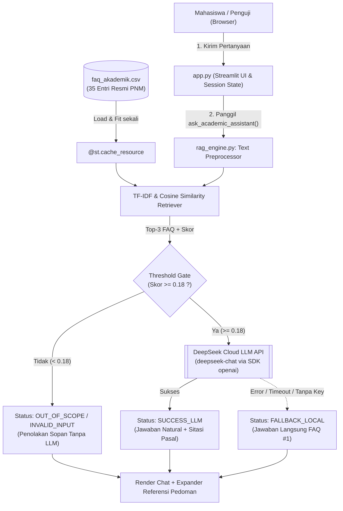

# 🎓 Chatbot FAQ Asisten Akademik Kampus (Politeknik Negeri Madiun)
**Berbasis Mini-RAG (TF-IDF + Cosine Similarity) & DeepSeek Cloud LLM**

Aplikasi web asisten akademik interaktif berbasis **Streamlit** yang membantu mahasiswa **Politeknik Negeri Madiun (PNM)**—khususnya **Program Studi Diploma Tiga (D-III) Teknologi Informasi**—mencari informasi aturan akademik, administrasi, perkuliahan, evaluasi nilai, cuti, magang, hingga tugas akhir secara cepat, akurat, dan bebas halusinasi.

---

## 📌 1. Latar Belakang & Solusi

Mahasiswa sering mengalami kesulitan menemukan pasal atau ketentuan spesifik di dalam dokumen PDF Buku Pedoman Akademik dan Kalender Akademik secara cepat. Pertanyaan berulang terkait batas jam alpa, perhitungan kompensasi (kompen), syarat nilai kelulusan semester, prosedur daftar ulang, ketentuan UKT saat cuti/dicutikan, hingga syarat predikat *Pujian (Cumlaude)* sering membebani Dosen Pembimbing Akademik (PA) dan admin program studi.

**Solusi yang dibangun:**
1. **Mini-RAG (*Retrieval-Augmented Generation*) Lokal:** Menggunakan `TfidfVectorizer` (`ngram_range=(1, 2)`, `sublinear_tf=True`, `token_pattern=r"(?u)\b\w+\b"`, dan *stopwords* Bahasa Indonesia terkurasi) serta `cosine_similarity` untuk mengambil **Top-3 pasal paling relevan** dari basis data FAQ resmi.
2. **Gerbang Anti-Halusinasi (*Threshold Gate* $\theta = 0.18$):** Pertanyaan di luar cakupan akademik ($S_{\max} < \theta$) atau input tidak valid langsung dihentikan dan ditolak dengan sopan **tanpa memanggil Cloud LLM**.
3. **Generasi Jawaban Natural dengan DeepSeek API (`deepseek-chat`):** Merangkum konteks pedoman menjadi jawaban yang ramah, terstruktur, dan selalu mencantumkan rujukan bab/halaman.
4. **Graceful Degradation (*Mode Fallback Lokal*):** Jika jaringan terputus, *timeout*, API Key belum diatur, atau kuota habis, aplikasi **tidak crash** dan otomatis menyajikan jawaban terverifikasi langsung dari basis data lokal Buku Pedoman Akademik.

---

## 🏗️ 2. Arsitektur Sistem



---

## 📚 3. Sumber Data & Cakupan Basis Pengetahuan

Seluruh **35 entri FAQ** di dalam [faq_akademik.csv](./faq_akademik.csv) diekstrak dari dokumen resmi institusi:
1. **Buku Pedoman Akademik Politeknik Negeri Madiun Tahun Akademik 2024/2025 — Program Studi Diploma Tiga Teknologi Informasi** (*Keputusan Direktur Politeknik Negeri Madiun Nomor: 265/04/PL33.001/HK/2024*, ditetapkan di Madiun tanggal 12 Agustus 2024). File referensi: [Pedoman Akademik Teknologi Informasi Tahun 2024-2025.pdf](./docs/pedoman/Pedoman%20Akademik%20Teknologi%20Informasi%20Tahun%202024-2025.pdf).
2. **Kalender Akademik Politeknik Negeri Madiun Tahun Akademik 2025/2026** (*Nomor: 0110/PL33/HK.07.01/2025*, ditetapkan tanggal 8 Agustus 2025). File referensi: [kaldik-pnm-2025-2026.png](./docs/pedoman/kaldik-pnm-2025-2026.png).

| Kategori | Jumlah Entri | Cakupan Topik Utama |
| :--- | :---: | :--- |
| **1. Registrasi & KRS** | 7 | Alur daftar ulang & KRS, sanksi terlambat daftar ulang, sistem paket SKS (D-II/D-III/D-IV), jadwal Kalender Akademik 2025/2026, hak bimbingan Dosen PA, arti 9 digit NPM & kode MK, kurikulum 112 SKS D-III TI. |
| **2. Perkuliahan & Kehadiran** | 7 | Sanksi jam alpa (SP I = 18 jam, SP II = 36 jam, SP III = 47 jam, DO = 56 jam), prosedur izin sakit/dispensasi, aturan perhitungan kompensasi (kompen 2x jam alpa), batas ketidakhadiran kumulatif (76/114/152 jam), tata tertib & busana, beban 1 SKS (45 jam) & kuliah daring (maks 25%), jadwal UTS (minggu ke-8) & UAS (minggu ke-16). |
| **3. Evaluasi & Penilaian** | 7 | Tabel konversi nilai PNM (A, AB, B, BC, C, D, E), rumus IPS & IPK, komponen Nilai Akhir (NA), syarat lulus semester (MK wajib C & batas maks 2 nilai D), 3 jenis Yudisium & evaluasi Lulus Percobaan, Minggu Remidi & mengulang MK, penerbitan KHS & batas 6 bulan pengambilan Ijazah/SKPI. |
| **4. Status Mahasiswa & Administrasi** | 7 | Syarat & prosedur Cuti Akademik, kewajiban UKT saat cuti pengajuan vs sanksi Dicutikan, kriteria status Dicutikan tingkat akhir, kriteria Putus Studi (DO), batas masa studi normal & maksimal (2x masa kurikulum), ketentuan UKT & KTM hilang/rusak, kewajiban PKKMB/Diklatsar & Wisuda. |
| **5. Magang / PKL & Tugas Akhir** | 7 | Magang D-III TI (Semester V, 20 SKS / 40 JP), konversi program MBKM (maks 20 SKS), pelaksanaan & bentuk Tugas Akhir (Semester VI, 4 SKS), penilaian & ujian ulang TA (minimal C), syarat Yudisium Akhir Studi, syarat predikat kelulusan (Pujian/Cumlaude IPK > 3,50 masa studi normal), gelar lulusan (`A.Md.Kom`). |

> **Lisensi & Penggunaan Data:** Dataset disusun untuk keperluan akademik dan edukasi pada mata kuliah **Sistem Cerdas (TI24317)** Program Studi D-III Teknologi Informasi Politeknik Negeri Madiun dengan merujuk pada dokumen pedoman resmi kampus.

---

## 🧪 4. Hasil Kalibrasi Threshold & Pengujian (`TC-01` s.d. `TC-06`)

Berdasarkan pengujian otomatis menggunakan [scripts/calibrate_threshold.py](./scripts/calibrate_threshold.py) pada 24 kueri benchmark (6 pertanyaan langsung, 12 parafrasa/bahasa santai mahasiswa, dan 6 kueri *out-of-scope*/acak):
- **Skor Terendah Kueri Akademik Valid (*Min In-Scope*):** `0.1966`
- **Skor Tertinggi Kueri Luar Topik (*Max Out-of-Scope*):** `0.0884`
- **Margin Pemisah Aman (*Separation Gap*):** `0.1083`
- **Threshold Default ($\theta = 0.18$):** Mencapai **18/18 (100%) akurasi & recall** pada kueri akademik dan **6/6 (100%) penolakan tepat** pada kueri *out-of-scope*.

| ID Uji | Skenario | Status Verifikasi |
| :--- | :--- | :--- |
| **TC-01** | Pertanyaan langsung sesuai FAQ | ✅ Lulus (`Top-1` pasal tepat, skor $\ge 0.18$) |
| **TC-02** | Pertanyaan parafrasa / bahasa santai (*"bolos"*, *"kompen"*, *"nilai D"*) | ✅ Lulus (`Top-1` pasal tepat, skor $\ge 0.18$) |
| **TC-03** | Pertanyaan *Out-of-Scope* (*"Resep nasi goreng..."*) | ✅ Lulus (`status = "OUT_OF_SCOPE"`, LLM tidak dipanggil) |
| **TC-04** | Input kosong / karakter acak (*"asdfghjkl"*) | ✅ Lulus (`status = "INVALID_INPUT"`, tidak crash) |
| **TC-05** | Kegagalan Cloud API (kunci tidak valid / saldo habis / offline) | ✅ Lulus (`status = "FALLBACK_LOCAL"`, tampil jawaban FAQ #1) |
| **TC-06** | Tombol Reset Percakapan di sidebar | ✅ Lulus (riwayat kembali ke pesan sambutan awal) |

---

## 🚀 5. Panduan Instalasi & Menjalankan di Lokal

### 5.1. Prasyarat
- Python `3.10+`
- Akun & API Key dari [DeepSeek Platform](https://platform.deepseek.com/api_keys) *(opsional: tanpa API Key aplikasi tetap dapat berjalan dalam Mode Fallback Lokal)*.

### 5.2. Langkah Instalasi
```bash
# 1. Clone repositori
git clone git@github.com:ahmadhakimitsnaini/ChatBot-Sistem-Akademik-.git
cd "ChatBot Akademik"

# 2. Buat dan aktifkan virtual environment
python3 -m venv .venv
source .venv/bin/activate   # macOS / Linux
# .venv\Scripts\activate    # Windows

# 3. Instal seluruh dependensi
pip install -r requirements.txt

# 4. Salin template environment dan isi DEEPSEEK_API_KEY
cp .env.example .env
```

Buka file `.env` dan isi kunci API Anda:
```env
DEEPSEEK_API_KEY="sk-xxxxxxxxxxxxxxxxxxxxxxxxxxxxxxxx"
DEEPSEEK_BASE_URL="https://api.deepseek.com"
DEEPSEEK_MODEL="deepseek-chat"
RAG_THRESHOLD="0.18"
```

### 5.3. Menjalankan Aplikasi & Pengujian
```bash
# Jalankan aplikasi Streamlit
streamlit run app.py

# Jalankan unit test otomatis
python -m unittest discover -s tests -v

# Jalankan skrip kalibrasi threshold
python scripts/calibrate_threshold.py
```

---

## ☁️ 6. Panduan Deployment ke Streamlit Community Cloud

1. Pastikan `.env` dan `.streamlit/secrets.toml` sudah tercantum di [.gitignore](./.gitignore) dan tidak ikut ter-commit.
2. Push seluruh kode ke branch `main` di GitHub.
3. Buka [share.streamlit.io](https://share.streamlit.io), klik **Create app**, lalu pilih repositori ini dengan file utama `app.py`.
4. Masuk ke **Advanced settings $\rightarrow$ Secrets** dan tambahkan konfigurasi berikut:
   ```toml
   DEEPSEEK_API_KEY = "sk-xxxxxxxxxxxxxxxxxxxxxxxxxxxxxxxx"
   DEEPSEEK_BASE_URL = "https://api.deepseek.com"
   DEEPSEEK_MODEL = "deepseek-chat"
   RAG_THRESHOLD = "0.18"
   ```
5. Klik **Deploy!**

---

## 📁 7. Struktur Direktori Proyek

```text
ChatBot Akademik/
├── app.py                        # Antarmuka Streamlit (UI, Sidebar, Session State, Cache)
├── rag_engine.py                 # Mesin Mini-RAG (TF-IDF, Cosine Similarity, DeepSeek LLM, Fallback)
├── faq_akademik.csv              # Dataset 35 entri resmi Buku Pedoman Akademik PNM & Kaldik
├── requirements.txt              # Daftar pustaka Python untuk instalasi lokal & Streamlit Cloud
├── .env.example                  # Template variabel lingkungan tanpa API Key asli
├── .gitignore                    # Konfigurasi pengabaian file sensitif (.env, secrets.toml, .venv)
├── README.md                     # Dokumentasi utama proyek
├── tests/
│   └── test_rag_engine.py        # Unit & integration test otomatis (TC-01 s.d. TC-06)
├── scripts/
│   └── calibrate_threshold.py    # Skrip evaluasi & kalibrasi nilai threshold (θ)
└── docs/
    ├── PRD.md                    # Product Requirements Document
    ├── architecture.md           # Dokumen Arsitektur Sistem & Kontrak Modul
    ├── todos.md                  # Roadmap & Checklist Pengerjaan Proyek
    ├── role.md                   # Panduan Kolaborasi Pengerjaan
    └── pedoman/                  # Dokumen Sumber Resmi Politeknik Negeri Madiun
        ├── Pedoman Akademik Teknologi Informasi Tahun 2024-2025.pdf
        └── kaldik-pnm-2025-2026.png
```
