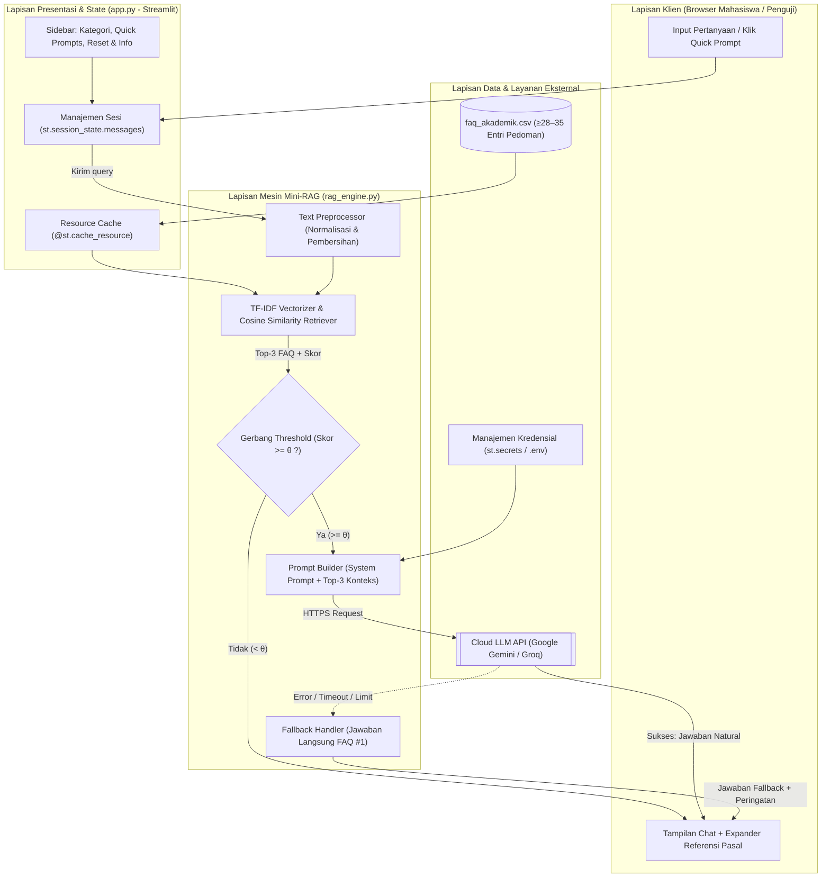
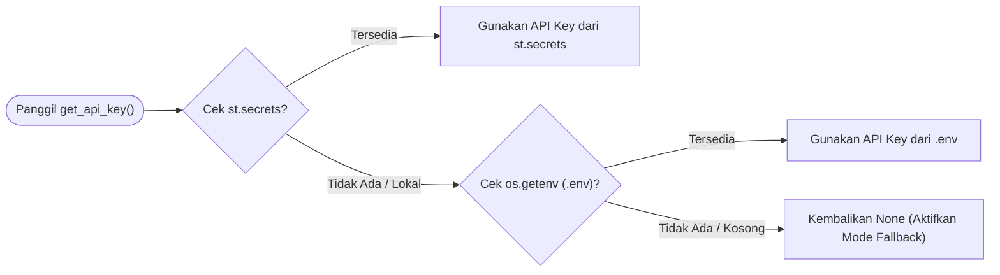
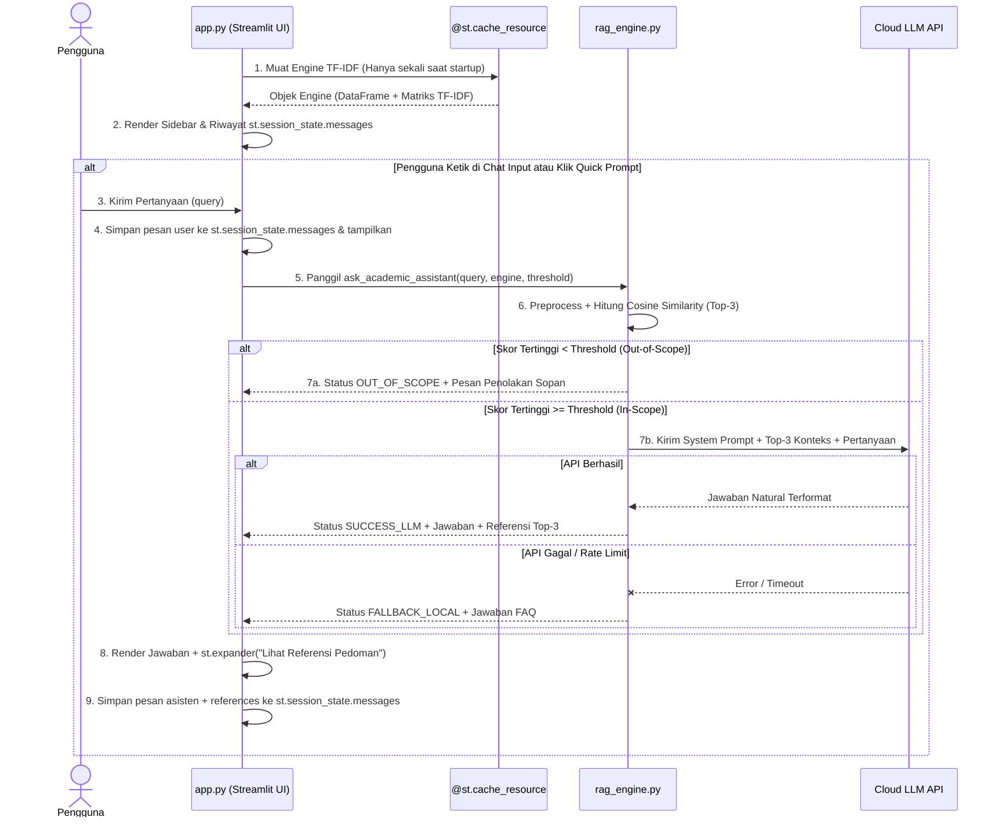

# Dokumen Arsitektur Sistem (*System Architecture Document*)
## Chatbot FAQ Asisten Akademik Kampus (Berbasis Mini-RAG & Cloud LLM)

> **Acuan Dokumen:** [PRD.md](./PRD.md) | [todos.md](./todos.md)  
> **Tujuan Dokumen:** Menjadi cetak biru (*blueprint*) teknis yang mendefinisikan struktur lapisan sistem, kontrak data antar-modul (`app.py` $\leftrightarrow$ `rag_engine.py` $\leftrightarrow$ `faq_akademik.csv`), pipeline matematika Mini-RAG, manajemen *state*, serta strategi ketahanan (*resilience/fallback*) agar siap diimplementasikan dan dijelaskan 100% saat demo/UAS.

---

## 1. Tinjauan Arsitektur Tingkat Tinggi (*High-Level Architecture*)

Sistem dirancang menggunakan pola **Modular Two-Tier Monolith** yang memisahkan secara tegas antara **Lapisan Antarmuka & Manajemen Sesi (`app.py`)** dan **Lapisan Logika Intelegensi & Data (`rag_engine.py`)**.

### 1.1. Prinsip Desain Utama
1. **Separation of Concerns (Pemisahan Peran):** `app.py` sama sekali tidak boleh menghitung vektor TF-IDF atau merakit *prompt* LLM; tugasnya murni merender UI Streamlit dan mengelola `st.session_state`. Sebaliknya, `rag_engine.py` dapat dijalankan dan diuji secara mandiri melalui terminal tanpa memerlukan server Streamlit yang aktif.
2. **Zero-Hallucination by Gatekeeping (Gerbang Anti-Halusinasi):** Sebelum memanggil Cloud LLM API, sistem wajib melewati gerbang matematis (*Cosine Similarity Threshold Gate*). Pertanyaan di luar konteks akademik dihentikan di gerbang ini.
3. **Graceful Degradation (Degradasi Terkendali / Fallback):** Kegagalan jaringan atau habisnya kuota Cloud LLM API tidak boleh menghentikan aplikasi; sistem otomatis beralih menampilkan jawaban terverifikasi dari entri FAQ dengan skor tertinggi.
4. **Compute Once, Query Many (Komputasi Sekali, Kueri Berkali-kali):** Pemuatan dataset CSV dan pembentukan matriks ruang vektor TF-IDF di-cache di memori server menggunakan `@st.cache_resource`.

### 1.2. Diagram Konteks & Lapisan Sistem



---

## 2. Arsitektur Data & Desain Indeks Pengetahuan (`faq_akademik.csv`)

Kualitas jawaban dalam arsitektur RAG sangat bergantung pada bagaimana data direpresentasikan saat proses indeksasi.

### 2.1. Skema Tabel Fisik (`faq_akademik.csv`)

| Nama Kolom | Tipe Data | Wajib | Deskripsi & Aturan Validasi | Contoh Nilai |
| :--- | :--- | :---: | :--- | :--- |
| `id` | `int` | Ya | Penanda unik baris FAQ ($1 \dots N$, dengan $N \ge 28$). | `1` |
| `kategori` | `string` | Ya | Satu dari 5 kategori standar pedoman akademik. | `Perkuliahan & Kehadiran` |
| `pertanyaan` | `string` | Ya | Pertanyaan utama yang diperkaya kata kunci/sinonim populer mahasiswa. | `"Berapa syarat minimal kehadiran (presensi/absen/batas bolos) untuk mengikuti UAS (ujian akhir)?"` |
| `jawaban` | `string` | Ya | Jawaban faktual, jelas, dan ringkas sesuai Buku Pedoman Akademik. | `"Mahasiswa wajib memenuhi kehadiran minimal 75% dari total pertemuan..."` |
| `sumber_pasal`| `string` | Ya | Rujukan bab, pasal, atau halaman dari Buku Pedoman Akademik. | `"Bab IV Pasal 12 Ayat (1)"` |

### 2.2. Strategi Pembentukan Kolom Virtual Pencarian (`search_text`)
Saat `faq_akademik.csv` dimuat ke dalam `pandas.DataFrame`, mesin `rag_engine.py` membentuk kolom komposit virtual bernama `search_text` dengan bobot penekanan pada pertanyaan:

$$\text{search\_text}_i = \text{preprocess}(\text{kategori}_i + \text{" "} + \text{pertanyaan}_i + \text{" "} + \text{pertanyaan}_i + \text{" "} + \text{jawaban}_i)$$

> **Alasan Arsitektural:** Menggandakan `pertanyaan_i` di dalam dokumen yang diindeks memberikan bobot frekuensi kata (*Term Frequency*) yang lebih tinggi pada istilah-istilah di kolom pertanyaan dan sinonimnya dibandingkan kata-kata umum di dalam paragraf jawaban panjang.

---

## 3. Pipeline Matematika & Algoritma Mini-RAG (`rag_engine.py`)

Bagian ini merinci tahapan pemrosesan dari teks mentah pengguna hingga menghasilkan konteks terperingkat.

### 3.1. Tahap 1: Pra-pemrosesan Teks (*Text Preprocessing*)
Setiap teks dokumen dan input pengguna melewati fungsi `preprocess_text(text: str) -> str`:
1. **Case Folding:** Mengubah seluruh huruf menjadi huruf kecil (`text.lower()`).
2. **Punctuation & Symbol Stripping:** Menghapus tanda baca dan karakter non-alfanumerik menggunakan *Regular Expression* `r"[^a-z0-9\s]"` sambil mempertahankan angka penting (misal: `75`, `24`, `sks`, `ipk`).
3. **Whitespace Normalization:** Menghapus spasi ganda atau karakter *newline* berlebih.

### 3.2. Tahap 2: Vektorisasi TF-IDF dengan *N-Gram*
Sistem menggunakan `TfidfVectorizer` dari pustaka `scikit-learn` dengan konfigurasi yang dioptimalkan untuk teks FAQ bahasa Indonesia:
* `ngram_range=(1, 2)`: Menangkap baik kata tunggal (*unigram* seperti `"cuti"`, `"sks"`, `"bolos"`) maupun frasa dua kata (*bigram* seperti `"ujian akhir"`, `"cuti akademik"`, `"tugas akhir"`, `"batas waktu"`).
* `sublinear_tf=True`: Menerapkan skala logaritmik $1 + \log(\text{tf})$ agar kata yang berulang berkali-kali dalam satu jawaban panjang tidak mendominasi skor kemiripan secara tidak proporsional.

### 3.3. Tahap 3: Perhitungan *Cosine Similarity* & Pengambilan *Top-$k$*
Untuk vektor kueri pengguna $\mathbf{q}$ dan vektor dokumen FAQ ke-$i$ yaitu $\mathbf{d}_i$, skor kemiripan dihitung dengan rumus:

$$\text{Similarity}(\mathbf{q}, \mathbf{d}_i) = \cos(\theta) = \frac{\mathbf{q} \cdot \mathbf{d}_i}{\|\mathbf{q}\| \|\mathbf{d}_i\|}$$

1. Sistem mengurutkan seluruh skor secara menurun (*descending*) dan mengambil $k = 3$ dokumen teratas (*Top-3*).
2. Skor tertinggi disimpan sebagai $S_{\max} = \max_i \text{Similarity}(\mathbf{q}, \mathbf{d}_i)$.

### 3.4. Tahap 4: Logika Keputusan Ambang Batas (*Threshold Gate*)
Sistem mengevaluasi $S_{\max}$ terhadap nilai ambang batas $\theta$ (default $\theta = 0.18$, dapat dikalibrasi pada rentang $0.15 - 0.25$):

* **Kondisi 1 (Input Kosong / Tidak Valid):** Jika setelah `preprocess_text` string kueri kosong atau vektor $\mathbf{q}$ bernilai nol semua ($S_{\max} == 0.0$), sistem langsung mengembalikan status `INVALID_INPUT` tanpa memanggil LLM.
* **Kondisi 2 (Di Luar Cakupan / *Out-of-Scope*):** Jika $0.0 < S_{\max} < \theta$, sistem mengembalikan status `OUT_OF_SCOPE` beserta pesan penolakan sopan standar tanpa memanggil LLM.
* **Kondisi 3 (Relevan / *In-Scope*):** Jika $S_{\max} \ge \theta$, sistem meneruskan *Top-3* entri FAQ ke tahap generasi jawaban Cloud LLM.

---

## 4. Kontrak Antarmuka Antar-Modul (*Module Interface Contract*)

Untuk menjaga kebersihan kode, komunikasi antara `app.py` dan `rag_engine.py` dibakukan melalui struktur fungsi dan struktur data (*dictionary contract*) berikut:

### 4.1. Spesifikasi Fungsi di `rag_engine.py`

```python
# 1. Memuat CSV dan membangun indeks TF-IDF
def initialize_rag_engine(csv_path: str = "faq_akademik.csv") -> dict:
    """
    Mengembalikan objek engine berisi:
    - 'df': pandas.DataFrame (dataset FAQ lengkap)
    - 'vectorizer': TfidfVectorizer (yang sudah di-fit)
    - 'tfidf_matrix': sparse matrix hasil transformasi seluruh FAQ
    """

# 2. Mencari Top-k konteks FAQ berdasarkan pertanyaan
def retrieve_faq(query: str, engine: dict, top_k: int = 3) -> list[dict]:
    """
    Mengembalikan list berisi top_k dictionary:
    [
        {
            "id": int,
            "kategori": str,
            "pertanyaan": str,
            "jawaban": str,
            "sumber_pasal": str,
            "score": float  # 0.0 s.d. 1.0
        },
        ...
    ]
    """

# 3. Fungsi Orkestrator Utama yang dipanggil oleh app.py
def ask_academic_assistant(
    query: str,
    engine: dict,
    threshold: float = 0.18,
    top_k: int = 3
) -> dict:
    """
    Mengembalikan dictionary hasil akhir dengan kontrak tetap:
    {
        "answer": str,             # Teks jawaban yang akan ditampilkan ke pengguna
        "status": str,             # "SUCCESS_LLM" | "OUT_OF_SCOPE" | "FALLBACK_LOCAL" | "INVALID_INPUT"
        "max_score": float,        # Skor kemiripan tertinggi
        "references": list[dict],  # Top-k entri FAQ beserta skornya untuk st.expander
        "error_detail": str | None # Pesan teknis singkat jika terjadi fallback API
    }
    """
```

---

## 5. Arsitektur Integrasi Cloud LLM & Prompt Engineering

### 5.1. Rancangan *System Prompt* Anti-Halusinasi
Saat status pencarian memenuhi $S_{\max} \ge \theta$, `rag_engine.py` merakit prompt dengan struktur tiga lapis:

```text
[PERAN & INSTRUKSI SISTEM]
Anda adalah "Asisten Akademik Kampus", asisten virtual resmi yang membantu mahasiswa memahami peraturan di Buku Pedoman Akademik.
Tugas Anda adalah menjawab pertanyaan mahasiswa HANYA berdasarkan [KONTEKS PEDOMAN AKADEMIK] yang diberikan di bawah ini.

Aturan Ketat:
1. Jawablah dengan bahasa Indonesia yang sopan, ramah, jelas, dan terstruktur.
2. Cantumkan rujukan sumber pasal/bab (misal: "Berdasarkan Bab IV Pasal 12...") sesuai konteks yang relevan.
3. DILARANG KERAS mengarang, menebak, atau menambahkan aturan akademik di luar konteks yang tersedia.
4. Jika dari ketiga konteks yang diberikan ternyata tidak ada yang menjawab inti pertanyaan pengguna, katakan dengan jujur bahwa informasi spesifik tersebut belum tercantum dalam basis data FAQ pedoman saat ini.

[KONTEKS PEDOMAN AKADEMIK (TOP-3 HASIL RETRIEVAL)]
---
Referensi 1 (Skor Kemiripan: {score_1:.2f} | Kategori: {kategori_1} | Sumber: {sumber_pasal_1})
Pertanyaan Terkait: {pertanyaan_1}
Isi Aturan/Jawaban: {jawaban_1}
---
Referensi 2 (Skor Kemiripan: {score_2:.2f} | Kategori: {kategori_2} | Sumber: {sumber_pasal_2})
Pertanyaan Terkait: {pertanyaan_2}
Isi Aturan/Jawaban: {jawaban_2}
---
Referensi 3 (Skor Kemiripan: {score_3:.2f} | Kategori: {kategori_3} | Sumber: {sumber_pasal_3})
Pertanyaan Terkait: {pertanyaan_3}
Isi Aturan/Jawaban: {jawaban_3}
---

[PERTANYAAN MAHASISWA]
{user_query}
```

### 5.2. Parameter Inferensi LLM
* **Temperature:** `0.1` (sangat rendah untuk meminimalkan variasi kreatif dan memastikan determinisme faktual).
* **Max Output Tokens:** `512` token (cukup untuk penjelasan lengkap 1–3 paragraf beserta poin-poin aturan tanpa memperlambat waktu respons).
* **Target Latensi:** $\le 3.5$ detik untuk panggilan API sehingga total waktu respons *end-to-end* tetap $\le 5$ detik (*NFR-01*).

---

## 6. Arsitektur Keamanan Kredensial & Mekanisme Fallback

### 6.1. Rantai Resolusi Kunci API (*Hybrid Credential Resolution Chain*)
Untuk menjamin aplikasi berjalan mulus baik di laptop pengembang maupun di Streamlit Community Cloud tanpa mengubah kode:



### 6.2. Strategi Penanganan Galat (*Fault-Tolerant Fallback*)
Apabila `get_api_key()` mengembalikan `None`, atau pemanggilan Cloud LLM API di dalam blok `try-except` melempar eksepsi (`TimeoutError`, `RateLimitError`, `AuthenticationError`, `ConnectionError`):
1. Sistem **tidak menampilkan *traceback* error Python** ke layar pengguna (*TC-05*).
2. Sistem otomatis mengeksekusi fungsi `build_fallback_response(top_reference)` yang menyusun jawaban langsung dari kolom `jawaban` dan `sumber_pasal` pada referensi peringkat ke-1 (`references[0]`).
3. Sistem mengembalikan status `"FALLBACK_LOCAL"` sehingga `app.py` dapat menampilkan lencana informasi kecil (`st.caption` / `st.info`) bahwa jawaban disajikan langsung dari basis data lokal Buku Pedoman Akademik.

---

## 7. Arsitektur Antarmuka Pengguna & Siklus Hidup State (`app.py`)

### 7.1. Struktur Memori `st.session_state`
Agar riwayat obrolan dan *expander* referensi tetap utuh selama pengguna berinteraksi di halaman, `st.session_state` dikelola dengan skema berikut:

```python
st.session_state = {
    # Menyimpan seluruh riwayat percakapan selama tab browser aktif
    "messages": [
        {
            "role": "assistant",          # "user" atau "assistant"
            "content": "Halo! Saya...",   # Teks pesan markdown
            "status": "WELCOME",          # Status respons untuk styling UI
            "references": []              # List dict Top-3 FAQ (khusus role="assistant")
        }
    ],
    # Menyimpan antrean pertanyaan saat pengguna menekan tombol Quick Prompt di Sidebar
    "pending_prompt": None
}
```

### 7.2. Siklus Eksekusi (*Execution Lifecycle*) di Streamlit



---

## 8. Tata Letak Direktori & Pemetaan Tanggung Jawab File

```text
ChatBot Akademik/
├── app.py                  # [Lapisan Presentasi] Konfigurasi UI Streamlit, Sidebar, Quick Prompts,
│                           # manajemen st.session_state, caching @st.cache_resource, dan render Expander.
├── rag_engine.py           # [Lapisan Logika & RAG] Preprocessing teks, TfidfVectorizer, Cosine Similarity,
│                           # evaluasi Threshold, resolusi API Key hibrida, Prompt Builder, & Fallback Handler.
├── faq_akademik.csv        # [Lapisan Data] Basis pengetahuan terstruktur (≥28–35 entri FAQ Buku Pedoman)
│                           # yang sudah diperkaya sinonim istilah mahasiswa.
├── requirements.txt        # [Konfigurasi Deploy] Daftar pustaka Python untuk instalasi lokal & Streamlit Cloud.
├── .env.example            # [Template Konfigurasi] Contoh file variabel lingkungan tanpa API Key asli.
├── .gitignore              # [Keamanan Git] Mencegah .env, secrets.toml, dan cache Python terunggah ke GitHub.
├── PRD.md                  # [Dokumentasi Produk] Spesifikasi kebutuhan fungsional & non-fungsional.
├── architecture.md         # [Dokumentasi Teknis] Cetak biru arsitektur sistem, alur data, & kontrak modul.
├── todos.md                # [Manajemen Proyek] Roadmap dan daftar periksa pengerjaan bertahap.
└── README.md               # [Dokumentasi Publik] Panduan penggunaan, penjelasan sumber data, & link demo.
```
